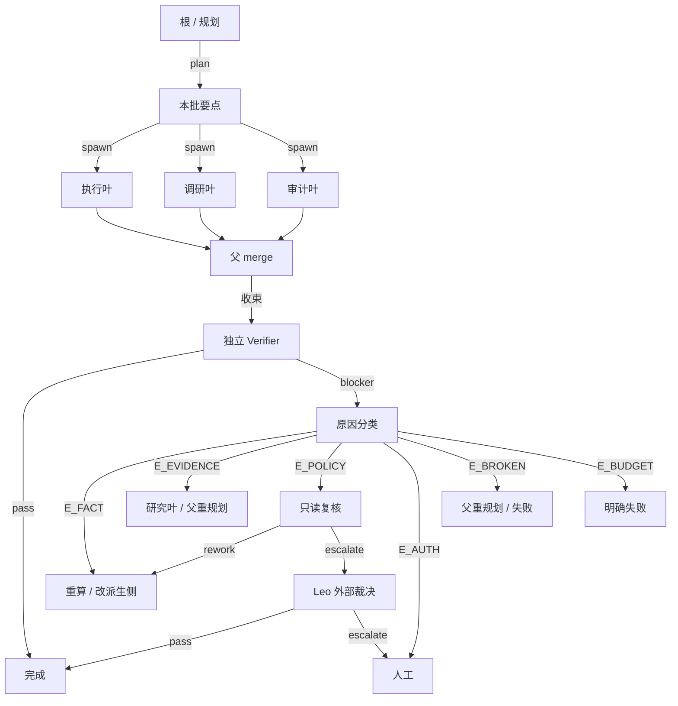

# Agent Harness：小模型可验收逻辑树

> 用 Harness 而不是换模型，让本地小模型完成长任务。

这个项目解决的不是「模型会不会写代码」，而是「模型写完的东西谁来判、判不了怎么办、判错了怎么恢复」。它把复杂任务展开成一棵可验收的逻辑树：叶子只做一件可机械核验的事，父节点只负责汇总与再派，完成与否由独立 Verifier 判决，不依赖模型自评。

面向的场景：Mac mini 上的 4bit 本地小模型，注意力差、上下文短、工具遵循率低。直接让 Claude Code / Pi 跑长任务会失败；换大模型成本高。这个项目的假设是「用小模型 + 结构」换质量。

---

## 它解决什么问题

- **长任务会漂移**：上下文越长，小模型越容易丢约束。逻辑树把任务拆小，每片只带自己需要的上下文。
- **模型自评不可信**：让模型说「我做完了」没有意义。判据必须是程序可计算的：文件存在、数值等于 oracle、schema 合法、产物哈希不变。
- **判不了就无限上升**：旧实现把所有 blocker 都送到「修复 → 复核 → 外部裁决」，事实冲突也被当成判断题。现在先分类原因，再选最便宜的处理通道。
- **提示词约束不是机制约束**：修复叶可以直接改只读输入或受保护产物。现在用 run 级 `authority.json` + macOS sandbox 做路径级写限制。

---

## 架构



### 逻辑树

- 20 字段节点；状态机：待跑 / 在跑 / 完成 / 失败 / 等子节点 / 等裁决。
- plan → spawn → merge 三阶段；batch 语义保证父只在当前批子节点全终结后才 merge。
- 三条运行期断言：终态封闭、等子节点时该层写冻结、round 单调递增且不超限。
- state.json / SQLite 快照；跨轮次 resume；已完成节点不重跑。

### 角色隔离

根 / 规划 / 决策 / 执行 / 调研 / 审计。每个角色独立配置 thinking、上下文预算、输出预算、工具白名单、写权限、轮次上限。父不写文件，审计只读无工具。

### 独立验收

- 程序侧：schema、证据引用、产物哈希、结构断言、覆盖检查。
- 只读复核叶：同一模型、不同上下文、逐 blocker 输出 `pass/rework/escalate` + `covers` + `evidence`。
- 外部裁决：Leo 持久回执，绑定 `issue_id + candidate_sha256 + artifact_snapshot`；跨进程恢复，重复提交为零。
- `pass` 只清除绑定的 blocker；硬机械检查每级都重跑。

### 上升机制：按原因路由

| 原因 | 典型现场 | 通道 |
|---|---|---|
| `E_FACT` | 报告 186 vs 权威 oracle 168 | 重算 / 回读权威 / 改派生侧 |
| `E_EVIDENCE` | 文件读不到、缺关键约束 | 研究叶 / 父重规划 |
| `E_POLICY` | 两种做法都合法、质量判断 | 只读复核 → Leo |
| `E_AUTH` | 删除、发布、付款、权限 | 直接人工 |
| `E_BROKEN` | 同一失败换 2 种策略仍失败 | 父重规划 → 耗尽失败 |
| `E_BUDGET` | 轮次 / 节点 / token 到顶 | 明确失败 |

**只有 `E_POLICY` 允许走到外部裁决。** 事实冲突、证据缺口、方法失效、预算耗尽都不该找 Leo。

### 权威边界

run 级 `authority.json`：

```json
{
  "authoritative": ["input/prime-oracle.json"],
  "read_only": ["input/", "product/answer.txt"],
  "writable": ["blocks/prime-report.md", "doc/"]
}
```

- 终审、修复叶、复核叶都会收到程序从磁盘读出的真实事实表。
- 冲突型 blocker 被机械改写成「权威 X = 168；可写目标 Y 当前 186，必须改为 168」。
- macOS sandbox 先 deny 整个 run 目录，再只 allow `writable` 路径 + pi 会话目录；模型物理上改不了 `input/` 和受保护产物。

---

## 仓库结构

```
harness/            # 运行时包（stage 1 扁平；模块职责见 docs/architecture.md）
  node.py           # 20 字段 + 状态机 + 三条断言
  driver.py         # plan / spawn / merge
  leafrun.py        # 调度循环、恢复、裁决等待
  final_audit.py    # 终审、blocker 机械核验、修复/复核派发
  escalation.py     # 原因分类与路由
  authority.py      # 权威清单、事实表、冲突改写
  session.py        # 模型调用、sandbox profile
  audit.py          # 审计账本与检查点
  schema.py         # 契约
  contract.py       # 失败分类与恢复策略
tests/              # 离线 unittest，不联网、不调模型
examples/
  prime-report/     # 168 vs 186 的权威冲突示例
docs/
  architecture.md
  escalation.md
  authority.md
```

---

## 快速开始

```bash
python3 -m venv .venv && source .venv/bin/activate
pip install -e .
python -m unittest discover -s tests -p 'test_*.py'
```

离线测试覆盖：状态机、schema、证据、终审、裁决回执、权威方向、sandbox profile、自愈策略。

真实运行需要本地模型服务（mlx_vlm / LLAAT）和 pi；见 `docs/architecture.md` 的 Runtime 一节。

---

## 结果

| 验收 | 结果 |
|---|---|
| A 裁决恢复 | PASS：真实 Leo pass 回执，8/8 检查，跨进程恢复 |
| G2 q01 | PASS：`product/answer.txt == "168\n"` |
| G2 agg2 | PASS：`product/agg.json` 逐键等于 oracle |
| B 自愈 | 见 `docs/acceptance.md`（修复前两次 FAIL，修复后待填） |
| 离线测试 | 107 项（Python 3.9.6） |

---

## 限制

- 复核叶不是独立模型；Leo 才是外部裁决。
- sandbox 仅 macOS；Linux 需要 namespace / seccomp 等价实现。
- 用户裁决没有恢复 CLI；节点会停在「等裁决」。
- B 夹具是人工构造的冲突场景，不代表自然任务分布。
- stage 1 仍是扁平包；`driver.py` / `leafrun.py` / `final_audit.py` 较大，后续按 `docs/architecture.md` 的子包边界拆分。

---

## License

MIT
